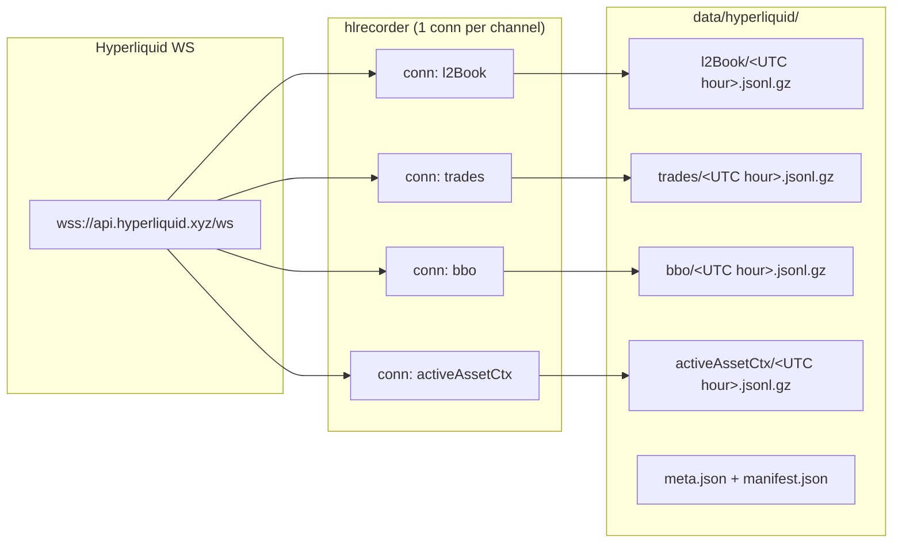

# Perp Collector Spec — implementation reference for the Hyperliquid raw recorder

Written 2026-10-04. This is the **implementation** reference for building the perp
(Hyperliquid) collector, and it records what the existing `go-collector` does and does
not give us.

**Two documents, two jobs:**

| Document | Authoritative for |
| --- | --- |
| [`RECORDER_SPEC.md`](RECORDER_SPEC.md) | The **wire/file contract**: what to subscribe, the `<rx_ns>\t<frame>\n` line format, rotation, sentinels, and the mapping to Nautilus types. Written from the ingest side. |
| `PERP_COLLECTOR_SPEC.md` (this file) | The **implementation**: architecture, what exists today, what is missing, decisions taken, costs measured, and what still needs verifying against a live capture. |

If the two disagree on *format*, `RECORDER_SPEC.md` wins — `py_perpbt.data.ingest` parses
it. If they disagree on *how to build it*, this file wins.

---

## 1. Concept

A **launch-and-forget raw recorder** for Hyperliquid perpetuals, feeding
NautilusTrader backtests. The collection goal is *raw capture*, not understanding: a
capture is irreplaceable (you cannot re-fetch an hour of L2 that you failed to record),
so the recorder must survive venue quirks and its own bugs without losing bytes.

Two hard properties follow, and they are the whole design:

1. **Never parse.** The recorder writes received frames to disk and does nothing else.
   No JSON decode, no typed struct, no re-encode. A parse bug then cannot lose data, and
   a new venue field needs no code change.
2. **Memory flat in message count.** Bounded by buffer sizes, never by how many frames
   have arrived, so a week-long run has the same RSS profile as the first minute.

### The load-bearing consequence: route by connection identity

Because the recorder never looks inside a frame, it **cannot** decide where a frame goes
by inspecting it. So routing must be decided *before* the frame arrives:

> **One WebSocket connection per channel.** Each connection subscribes to every coin for
> exactly one channel, and every frame that arrives on it is written to that channel's
> file. The destination is a property of the connection, not of the payload.

This is why `RECORDER_SPEC.md` §1 mandates the connection layout, and it is the reason
the existing collector cannot be adapted by config — that collector's entire model is
parse-then-route.



At 5 coins that is 4 connections and 20 subscriptions, against venue limits of 10
connections / 1000 subscriptions per IP. Comfortable.

---

## 2. Findings: does the existing collector support this?

**No. There is zero Hyperliquid support, and the gap is architectural, not configurational.**

Verified 2026-10-04 by reading the code:

| Check | Result |
| --- | --- |
| `grep -ri hyperliquid` over the repo | 14 hits, **all inside `RECORDER_SPEC.md`** (the doc itself) |
| `go-exchange-connector@v0.6.0/pkg` | `binance`, `polymarket`, `websocket` — **no `hyperliquid` package** |
| `cmd/collector/main.go` | Hardwired: `polymarket.New(false, cfg.Connector, rt.Now)` |
| Config schema | `polymarket.Config` + `SeriesConfig` + `RecordingConfig{epoch: noon_et}` — no venue abstraction |
| One-shot REST `/info` dump | None. `meta.json` has no equivalent anywhere |
| Raw-frame write path | None. Everything goes through `EventCollector.HandleEvent(ev any)` → typed → `json.Encoder` |

The existing recorder is **daily-epoch, Polymarket-market-centric**: it discovers Gamma
events, records the markets settling at a target instant, and files everything under a
noon-ET epoch. None of that has a Hyperliquid analogue — there are no markets to
discover, no settlement instants, and no epochs. The only shared concept is "stream to
gzip".

**Conclusion:** a new binary. `cmd/collector`, `pkg/services/collector`,
`collector.yaml` and `collector_daily.yaml` stay untouched.

---

## 3. What is missing on the collector

Grouped by layer. Each row is a thing that must be **built**, not configured.

### 3.1 Venue support

| Missing | Detail |
| --- | --- |
| Hyperliquid client | No `pkg/hyperliquid` in `go-exchange-connector`. No subscription builder, no payload types, no info REST client. |
| `meta.json` capture | Nothing POSTs `/info` `{"type":"meta"}`. Without it the ingest cannot build instruments and **the catalog is useless** (`RECORDER_SPEC.md` §2). |
| `perpDexs` capture | Same, only needed for HIP-3 markets. |

### 3.2 Transport layer

| Missing | Detail |
| --- | --- |
| App-level ping | `BaseWebSocket`'s ping loop sends **WebSocket control** pings. Hyperliquid's `{"method":"ping"}` is an **application-level JSON message** — a different thing. Needs its own ticker per connection. |
| Safe staleness default | `WSOptions.DataStaleTimeout` defaults to **5000 ms** and force-reconnects a quiet channel. `bbo` fires only on change and `trades` is bursty, so this would manufacture fake reconnect gaps. Must set `DisableDataStaleWatchdog: true`. |
| Read limit | Defaults to coder/websocket's **32 KiB**. Fine for 5-level books, a silent footgun if `fast` is ever turned off. Set explicitly. |
| Channel identity | No abstraction for "one connection = one channel". The existing clients multiplex many streams per connection. |

### 3.3 Write path

| Missing | Detail |
| --- | --- |
| Raw line format | Existing format is a `RecordedEvent` JSON envelope (`seqID`, `type`, `timestamp`, `receivedAt`, `data`). The spec needs `<rx_ns>\t<verbatim frame>\n` with **nanosecond** rx time — the existing recorder stores `UnixMilli` and wraps the payload. |
| UTF-hourly rotation | Existing rotation is epoch-anchored (noon ET) plus `DefaultFeedPartBytes` (256 MiB) part rotation. Needed: one file per channel per **UTC hour**, rotated on the **local receive clock**. |
| Crash marker | No `.open` suffix → no `.open` → final rename. A crash leaves an `events.gz` that *looks* complete. `RECORDER_SPEC.md` §3 requires the converter be able to tell the two apart. |
| Timer flush | Existing flushes on a **record count** (`f.count%feedFlushEvery == 0`, `feedFlushEvery = 512`). Needed: a ~1 s timer, so `kill -9` costs at most one second and the current hour is readable mid-write. |
| Raw byte writer | No path that writes an unparsed `[]byte`. `FeedRecorder.writeOne` unconditionally `json.Marshal`s a typed value. |
| Sentinel lines | No `_meta` `resubscribed` / `disconnected` lines inline in the frame stream. `RecordConnectionEvent` exists but writes **metadata**, not an in-band marker. |

### 3.4 Safety and operations — the ones that bite on a 10 GB box

| Missing | Detail |
| --- | --- |
| **Disk free-space guard** | **Nothing in the repo watches free space.** The Polymarket feed never needed to: it is *event-driven*, so a quiet market writes nothing and its volume self-limits. Hyperliquid's `l2Book` is a **paced** feed — a snapshot every ~0.5 s whether or not anything happens. This is the first workload in this repo that can actually fill a disk. Failure mode is bad: disk full → `gzip` writes fail → **silently truncated hour**. |
| Quiet-channel detection | Because we never parse, a silently failed subscription is **invisible**. Per-channel frame counters plus a "no frames in N seconds" warning are the *only* way to notice. Not a nice-to-have. |
| Drop accounting | `FeedRecorder` counts drops (`f.drops`) but nothing surfaces them in a manifest. A capture that dropped frames must be visibly not-clean. |
| Deploy | `deploy.sh` does `rm -rf /root/go-collector` first (re-deploying destroys recorded data) and hardcodes `bin/collector` + `collector_daily.yaml`. |
| Download / clear | `download.sh` / `clear.sh` assume the Polymarket `data/` tree. |
| Config strictness | `TestShippedConfigsDecode` + `dec.KnownFields(true)` is the precedent to mirror for the new config, so a typo'd key is an error rather than a silent no-op. |

### 3.5 What *is* reusable

Only three things, and one of them is a pattern rather than code:

1. **`websocket.BaseWebSocket`** (already a dependency) — reconnect loop, exponential
   backoff, ping/pong watchdog, status tracking, and its stub-safe test harness.
   - `OnConnect(ctx, conn) error` — fires after `b.conn` is set and before the read loop
     starts, on **every** successful dial, so it covers reconnects for free. Subscribe
     here, and write the `resubscribed` sentinel here.
   - `OnMessage(ctx, data []byte) error` — the raw frame. An error is logged, not fatal.
2. **`pkg/services/runtime`** — trivial, but gives `rt.Now` / `RootContext` consistent
   with the other binary.
3. **The `FeedRecorder` concurrency *pattern*** (not its code): bounded `chan` +
   single writer goroutine + `select/default` drop + throttled drop warning.

> **`OnMessage` runs synchronously on the read-loop goroutine.** Doing gzip or disk I/O
> there means disk latency throttles frame reads, which makes the venue drop the
> connection. The queue is not an optimization; it is required.

---

## 4. Design of the new recorder

### 4.1 File map

```
cmd/hlrecorder/main.go              new binary; strict YAML load, signals, wiring, shutdown order
collector_hl.yaml                   shipped config
deploy-hl.sh                        separate remote dir; cannot destroy the Polymarket capture
pkg/services/hyperliquid/
  config.go        Config + Load (KnownFields(true)) + Validate
  channels.go      channel registry: name -> subscription builder; the closed set of valid channels
  meta.go          POST /info {"type":"meta"} -> meta.json verbatim; manifest.json
  writer.go        HourlyWriter: rx_ns + tab + raw frame, gzip+bufio, .open -> final rename
  sink.go          per-channel bounded queue + writer goroutine + flush ticker + counters
  recorder.go      one BaseWebSocket per channel; subscribe; ping ticker; sentinels; disk guard
  *_test.go        line format, rotation, rename, config decode/validation, subscription bodies
```

**One new direct dependency:** `github.com/coder/websocket`, needed only to name the
`*coderws.Conn` parameter of `OnConnect`. It is already pinned at v1.8.12 as an indirect
dep of the connector, so `go mod tidy` promotes the existing version — nothing new is
downloaded.

### 4.2 Write path — three tiers

| Moment | Frequency | What happens |
| --- | --- | --- |
| `gz.Write(frame)` | every frame | CPU only (hash-match against the 32 KiB sliding window); output goes to flate's internal buffer. **No syscall.** |
| `gz.Flush()` then `buf.Flush()` | ~1/s | flate emits a byte-aligned **sync block**; bufio pushes it out → **one `write()` syscall**. |
| `gz.Close()`, `file.Sync()`, `Close()`, `os.Rename` | hourly | final block + CRC trailer, then `.open` → final. |

Order matters: `bufio.Writer` wraps the file, `gzip.Writer` wraps the `bufio.Writer`, so
flush must be `gz.Flush()` → `buf.Flush()`, and close must be `gz.Close()` → `buf.Flush()`
→ `Sync` → `Close` → `Rename`.

### 4.3 Frame ownership — no copy needed

`coder/websocket.Read` returns a **freshly allocated** `[]byte` per message, so the slice
handed to `OnMessage` is owned by us and can be queued without copying. `time.Now()` is
sampled **inside `OnMessage`**, on the read-loop goroutine — not when the writer dequeues.
Otherwise queueing delay would pollute `rx_ns`, and a frame queued before an hour boundary
could rotate into the wrong file.

### 4.4 Sentinels — per connection, not per file

`RECORDER_SPEC.md` §3 wants `_meta` lines on (re)connect and disconnect. Two design notes:

- **A sentinel belongs to its own channel's file only.** Connections are independent, so a
  drop on `trades` is a hole in `trades` and nothing else. (An earlier draft of this design
  said to write sentinels to all four files; that was wrong.)
- **`BaseWebSocket.Close()` does *not* fire `OnDisconnect`** — the read loop suppresses it on
  a deliberate shutdown. `Disconnect()` (including the internal call after a pong timeout)
  *does*. So `OnDisconnect` maps exactly to "unexpected drop" and needs no suppression logic.
  A clean shutdown instead writes a terminal `{"channel":"_meta","event":"stopped"}` line —
  an addition beyond `RECORDER_SPEC.md`, so the ingest can tell "recording ended" from
  "recording was cut off". Flagged in §7 as worth confirming with the ingest author.

### 4.5 Startup one-shots

1. `POST https://api.hyperliquid.xyz/info` body `{"type":"meta"}`; save the response body
   **verbatim** to `{root}/meta.json`. Validate with `json.Valid` (cheap; catches an HTML
   error page from a proxy) but do not parse it — the ingest owns interpretation.
2. Optionally the same for `{"type":"perpDexs"}` → `perpDexs.json`, only if HIP-3 markets
   are being recorded.
3. Write `manifest.json` (coins, channels, params, start time, version). **Rewrite it at
   clean shutdown** with `ended_ns` and per-channel frame/drop counts, so a capture carries
   its own provenance.

**`meta` failure fails the run.** Retry a few times, then exit non-zero. Recording hours of
frames into a capture with no instrument definitions produces an unusable catalog, and the
failure would otherwise only surface much later.

### 4.6 Shutdown order

```
SIGINT/SIGTERM
  -> cancel ctx (stop ping tickers, stop the disk guard)
  -> ws.Close() on every connection      (no more frames produced)
  -> sink.Stop() on every channel        (drain queues, gz.Close, sync, rename .open)
  -> rewrite manifest.json with final counts
  -> exit 0
```

Connections stop **before** sinks drain, so nothing can enqueue after a sink closed. Hang
up is documented as losing at most one flush interval (~1 s); `kill -9` is documented as
leaving `.open` files, which is precisely what the suffix is for.

### 4.7 Disk free-space guard

Checked on every hourly rotation and on the flush tick. Below `min_free_bytes`, log loudly
and stop **cleanly** — the point is that the `.open` → final rename still runs, so you keep
a valid, complete capture rather than a truncated file. This is the highest-value addition
for the 10 GB target and has no equivalent anywhere in the repo.

---

## 5. Config

```yaml
# data/hyperliquid/
data_dir: data/hyperliquid

coins:
  - BTC
  - ETH
  - SOL
  - HYPE
  - DOGE

channels:
  - l2Book
  - trades
  - bbo
  - activeAssetCtx

l2Book:
  fast: true          # 5 levels instead of 20; ~halves l2Book bytes
  # nSigFigs: deliberately unset — RECORDER_SPEC.md §1 says do NOT set it
  #          (it thins prices as well as levels, losing raw precision)
  # mantissa: only legal together with nSigFigs: 5

connector:
  ws_url: "wss://api.hyperliquid.xyz/ws"
  info_url: "https://api.hyperliquid.xyz/info"
  record_perp_dexs: false

recording:
  compression: default          # best_speed | default | best   (see §6.2)
  flush_interval_ms: 1000
  ping_interval_ms: 30000       # app-level {"method":"ping"}; 0 disables
  queue_size: 8192
  read_limit_bytes: 1048576
  min_free_bytes: 524288000     # 500 MiB; 0 disables the disk guard
  reconnect_interval_ms: 500
  reconnect_max_interval_ms: 30000
```

Validation, each rule guarding a real footgun:

| Rule | Why |
| --- | --- |
| `channels` ⊆ {`l2Book`,`trades`,`bbo`,`activeAssetCtx`,`allMids`} | A typo'd channel would silently produce an empty directory. |
| No duplicate coins or channels | Duplicate subscriptions waste connection budget and can double-write. |
| Coins trimmed, non-empty, no whitespace / `"` / `\` / control chars | They are interpolated into JSON subscription frames; this is the one injection surface. |
| ≥1 coin, ≥1 channel | A recorder with nothing to record should not start. |
| `mantissa` requires `nSigFigs == 5` | `RECORDER_SPEC.md` §1 states the constraint. Legal values 1, 2, 5. |
| `nSigFigs` ∈ [2,5] when set | Venue range. |
| `nSigFigs` and `mantissa` are `*int`, not `int` | "Unset" must be distinguishable from `0`, since the spec says *do not set* `nSigFigs`. Same for `fast`: `*bool`, omitted when nil, so we record what the venue defaults to unless asked otherwise. |
| Strict decode (`dec.KnownFields(true)`) | Mirrors `TestShippedConfigsDecode`; a typo'd key is an error, not a silent no-op. |
| Flush interval in (0, 60000] | A zero interval would spin. |

---

## 6. Measured costs and sizing

Measured 2026-10-04 with `.tmp/gzmem` (400,000 realistic l2Book frames, 454 B avg,
173 MB raw) on this Mac. Re-runnable: `go run ./.tmp/gzmem`.

### 6.1 Measurements

| Level | Ratio (synthetic) | Retained heap after open | Growth 10k → 400k frames | Alloc churn | Speed |
| --- | --- | --- | --- | --- | --- |
| BestSpeed (1) | 4.3:1 | ~0 KB | **+0.0 KB** | 3 B/frame | 122 MB/s |
| Default (6) | 6.1:1 | ~0 KB | **+0.0 KB** | 2 B/frame | 17 MB/s |
| Best (9) | 6.2:1 | ~0 KB | **+0.0 KB** | 2 B/frame | 3.5 MB/s |

Three results matter:

- **Compression is O(1) in message count.** Zero growth across 400,000 frames. If gzip
  buffered per frame, this would show hundreds of MB.
- **~1.15 MB per writer, and only once it has been written to.** Go's flate defers its
  window + hash tables to the first `Write`, which is why the "after open" line reads ~0.
  An idle channel costs nothing; four active channels cost ~4.6 MB.

  (The tool's `4 concurrent writers` line prints ~0 for the same reason — it creates
  writers but never writes to them. Do not read that line as "compression is free".)
- **2–3 bytes allocated per frame.** Compression produces essentially no garbage, so it
  adds no GC pressure — which is what actually matters on 1 CPU.

### 6.2 Compression level: deviate from `FeedRecorder`

`FeedRecorder` uses `gzip.BestSpeed` (`feeds.go:425`). **For this box that is the wrong
end of the trade.** BestSpeed is 7× faster but gives 4.3:1 against 6.1:1 — i.e. ~30% more
disk for CPU that is *already* under 1%:

| Level | CPU at 4 GB/day raw | Retention on a 10 GB disk |
| --- | --- | --- |
| BestSpeed | ~0.04% of one core | ~30% worse |
| **Default (6)** | **~0.27% of one core** | **baseline** |

CPU is ~99% idle — even at the pessimistic 4 GB/day the input is only ~46 KB/s, and it
is never parsed — while the disk is 10 GB and scarce. So the config exposes
`compression` and **defaults to `default` (level 6)**.
BestSpeed remains the right choice if the fleet ever scales past ~20 coins or gains
channels. `BestCompression` (9) is never worth it: +0.2% ratio for 4× the CPU of level 6.

The synthetic ratio is on a 1.78 MB sample of only slightly varying frames;
`RECORDER_SPEC.md` §6 estimates ~10:1 on real data. The **relative** cost/benefit is the
robust conclusion; one hour of real capture settles the absolute number.

### 6.3 Budget on the target droplet

| Component | RAM |
| --- | --- |
| Go runtime + binary | ~15 MB |
| 4 × flate compressor (level 6) | ~4.6 MB |
| 4 × `bufio.Writer` (64 KiB) | ~0.3 MB |
| 4 × queue, worst case (8192 items, disk stalled) | ~15 MB |
| **Total** | **~35 MB** |

Also: ~20 goroutines (per connection: read loop, reconnect loop, ping loop, app-level ping
ticker; per channel: writer goroutine — the data-staleness watchdog goroutine exits
immediately once `DisableDataStaleWatchdog` is set), and CPU well under 1%. **512 MB is
comfortable; 256 MB would work.** The 10 GB disk is the binding constraint — not RAM, not
CPU, and not gzip.

**Cheapest viable droplet: 512 MB / 1 vCPU / 10 GB.** Run one hour before committing to a
long capture and read the per-channel frame counts from `manifest.json`; `bbo` is the
volume wildcard (it fires per block, on change) and it — not compression — decides whether
the droplet is big enough.

---

## 7. Decisions locked

| Decision | Value |
| --- | --- |
| Location | New binary `cmd/hlrecorder` + new package `pkg/services/hyperliquid`. Existing Polymarket path untouched. |
| Output root | `data/hyperliquid/` (already covered by `.gitignore`'s `data/`). |
| Layout | `data/hyperliquid/{meta.json, manifest.json, <channel>/<UTC hour>.jsonl.gz}` |
| Deploy | Separate `deploy-hl.sh` with its own remote dir, so it cannot `rm -rf` the Polymarket capture. |
| Startup dumps | Both `meta.json` and `manifest.json`. |
| Disk guard | On by default, `min_free_bytes: 500 MiB`, **stops cleanly**. *Pending your confirmation* of stop-vs-warn. |
| Compression | Configurable, default `default` (6) — a deliberate deviation from `FeedRecorder`'s `BestSpeed`. |
| Part rotation | **None.** Hourly rotation already bounds files at ~10–40 MB compressed; `DefaultFeedPartBytes` (256 MiB) is meaningless against a 10 GB budget. |
| Connection model | One `BaseWebSocket` per channel; all coins subscribed on each. |
| `_meta stopped` | Added beyond `RECORDER_SPEC.md`, so a clean end differs from a cut-off capture. |

---

## 8. Unverified — confirm against one live capture

Nothing here has been tested against the venue. Each item is a way the recorder could be
silently wrong, so they are the first checks:

| # | Unverified | How to check |
| --- | --- | --- |
| 1 | **Subscription frame shape.** `RECORDER_SPEC.md` §1 shows bare `{"type":"l2Book","coin":"BTC"}`. Hyperliquid's WS API also documents `{"method":"subscribe","subscription":{...}}`. We implement the spec's form. | Connect one channel, send the bare form, confirm frames arrive rather than an error. A `.tmp/hlprobe` tool is the cheapest way. |
| 2 | **App-level ping.** Whether `{"method":"ping"}` is required, or whether WS control pings suffice, or whether the server pings us and expects pongs. | Observe a connection idle for >60 s and see if it stays open. |
| 3 | **`bbo` frame rate.** "Per block, on change" with fast blocks could make it the dominant channel. | Frame counts per channel after one hour. **This decides droplet size.** |
| 4 | **Real compression ratio.** Synthetic frames suggest 4.3–6.1:1; the spec estimates ~10:1. | Compressed bytes/hour after one hour, versus raw. |
| 5 | **`ReadLimit` headroom.** 1 MiB is set defensively; the real max frame size is unknown. | Log the largest frame seen; compare against the limit. |
| 6 | **`trades[].side` encoding** — `"B"/"A"` vs `"buy"/"sell"`. | Not the recorder's problem (we never parse) but the converter must accept both; worth confirming once. |
| 7 | **Whether 4 connections from one IP are fine long-term**, given the 30 new connections/minute limit and a 500 ms reconnect interval. | Watch for reconnect storms in the logs over a few hours. |

---

## 9. What "updating the collector to support Hyperliquid" means

Three options; **A is chosen**, B and C are recorded for later.

**A. A separate binary in the same repo (chosen).** `cmd/hlrecorder` + `pkg/services/hyperliquid`.
Zero risk to the working Polymarket collector, no venue abstraction to invent, and the two
share only `websocket` and `runtime`. Cost: two binaries to build and deploy — mitigated by
`deploy-hl.sh`.

**B. A venue abstraction inside `cmd/collector`.** Would require splitting
`EventCollector`/`RecordingSession`/`FeedRecorder` behind an interface and untangling the
epoch model from the write path. Large, invasive, and buys nothing today, because the two
venues share no write path (typed+epoch vs raw+hourly).

**C. Grow `pkg/hyperliquid` in `go-exchange-connector`.** The reusable parts are the
subscription builders and the `{"type":"meta"}` fetch — but this recorder never parses, so
it needs almost none of it. Worth doing only when a *second* consumer appears (e.g. the
Nautilus Hyperliquid adapter, or a fill-model calibration tool). Until then, keeping it
local avoids slowing the connector's release cycle for one consumer.

**Explicitly out of scope:** `py_perpbt.data.ingest` (the consumer, in another repo) and
anything that parses frames. Applying funding inside the backtest remains an open gap on
the ingest side per `RECORDER_SPEC.md` §7 — that is not a recorder problem, but it will
need a decision before funding data is usable.

---

## 10. Plan of record

Ordered so that the risky, unverified parts are exercised early:

1. `config.go` + `channels.go` — validation and subscription bodies (pure, testable).
2. `writer.go` — line format, rotation, `.open` rename, timer flush. Test with an
   injectable clock so hour-boundary and rename behaviour are pinned without waiting.
3. `sink.go` — queue, writer goroutine, drain, counters, drops.
4. `meta.go` — `/info` dumps, `manifest.json` write + rewrite.
5. `recorder.go` — connections, subscribe on `OnConnect`, ping ticker, sentinels, disk guard.
6. `cmd/hlrecorder/main.go` — flags, strict config load, shutdown order.
7. `.tmp/hlprobe` — connect to one channel, print the first few frames, and settle §8 items
   1–2. **Do this before a long run.**
8. `collector_hl.yaml` + `deploy-hl.sh`.
9. Tests passing the repo's gate: `gofmt -l`, `go build ./...`, `go vet ./...`,
   `go test ./...`, `go test -race ./...`.
10. One-hour live run; read `manifest.json`; settle §8 items 3–5; re-tune
    `compression` and `min_free_bytes` from the real numbers.

Plus the `RECORDER_SPEC.md` §9 checklist, and these additions:

- [ ] Disk guard stops **cleanly** at the threshold (`.open` → final still happens)
- [ ] `meta.json` fetched before any frame is written; absent `meta` fails the run
- [ ] `manifest.json` rewritten at shutdown with `ended_ns` and per-channel counts
- [ ] Per-channel drop counts non-zero ⇒ the capture is visibly not clean
- [ ] A quiet channel warns rather than hiding a failed subscription
- [ ] `deploy-hl.sh` cannot touch `/root/go-collector` (the Polymarket capture)
- [ ] `.open` → final rename verified by killing the process mid-hour
